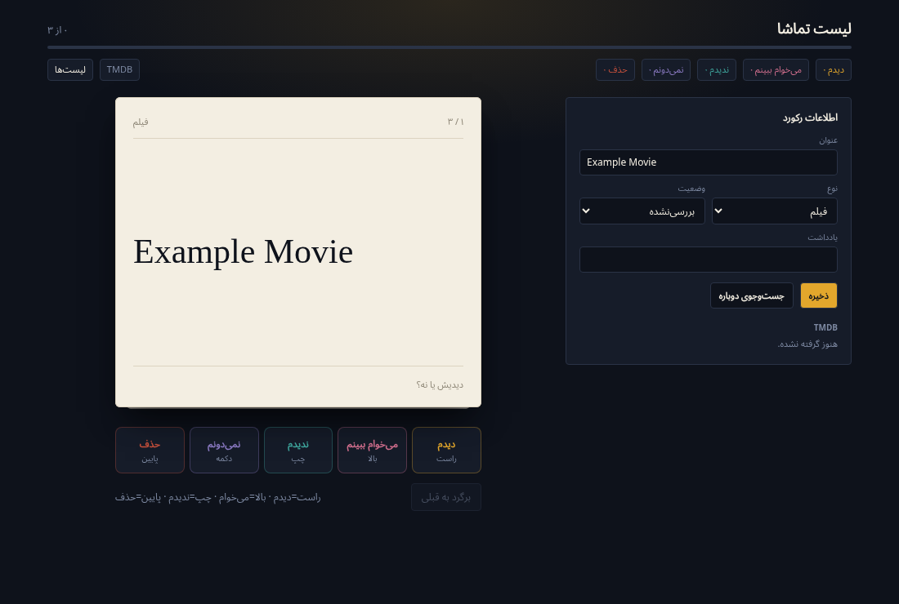

# Watchlist Swipe

A React application for sorting a watchlist with swipe cards and buttons. Decisions,
edits and poster metadata are stored in the current browser through `localStorage`;
embedded hosts can supply the compatible `window.storage` adapter.

## Features

- Five decision buckets: seen, wish, not seen, unsure and removed.
- Card and list views, undo, Persian/Latin titles and editable details.
- Optional TMDB metadata and poster lookup with a local cache.
- Export decisions as text or JSON.

## Run locally

Requires Node.js 22.12 or newer and npm. Install the versions recorded in the lockfile:

```sh
npm ci --ignore-scripts
npm run dev
```

Use `npm run build` for the production build and `npm run preview` to inspect it.

## Try the demo without a key

Open the local URL from Vite in a fresh browser profile. Leave the TMDB field
empty. The counter starts at `۰ از ۳` and the first card is **Example Movie**.



1. Press the right arrow to mark **Example Movie** as seen (`دیدم`).
2. Click the wish button (`می‌خوام ببینم`) on **Example Series**.
3. Swipe **Example Game** left to mark it as not seen (`ندیدم`).

The counter now reads `۳ از ۳`. Open the lists (`لیست‌ها`) and select a
category to see its title. Reload the same URL and open the lists again.
Each category still contains its title in this browser profile.

## Data and configuration

The published snapshot contains three fictional sample titles in `src/App.jsx`.
The original personal watchlist is deliberately absent. Replace the sample `RAW`
entries locally with objects using `t` for title and `k` for kind (`movie`, `series`,
`anime`, or `game`). Browser state is not part of this repository.

Poster lookup is optional. Copy `.env.example` to `.env` and set your own
`VITE_TMDB_KEY`, or enter a key in the poster settings panel. No fallback credential
is bundled. Vite exposes `VITE_` values to the browser; do not use this setting for
server credentials or confidential tokens. Without a key, titles and triage remain
available, and the app skips TMDB lookups.

## Project layout

- `src/App.jsx`: card/list interface, metadata lookup and sample list.
- `src/storage.js`: browser/host storage adapter.
- `src/main.jsx`, `src/index.css`: application entry and styling.
- `vite.config.js`, `tailwind.config.js`: development/build configuration.

## License and provenance

Original application code is proprietary; see `LICENSE`. Third-party dependencies
retain their own licenses and are installed separately. This repository imports a
preserved local project snapshot in present-day, functional commits; it does not
claim to reconstruct historical development dates. See `IMPORT_NOTES.md`.

This product uses the TMDB API but is not endorsed or certified by TMDB.

## Validation

`npm test` exercises empty-key, cancellation and configured-key bulk lookup behavior with a mocked network. Use the steps above to check the keyless card and list workflow in a browser.
